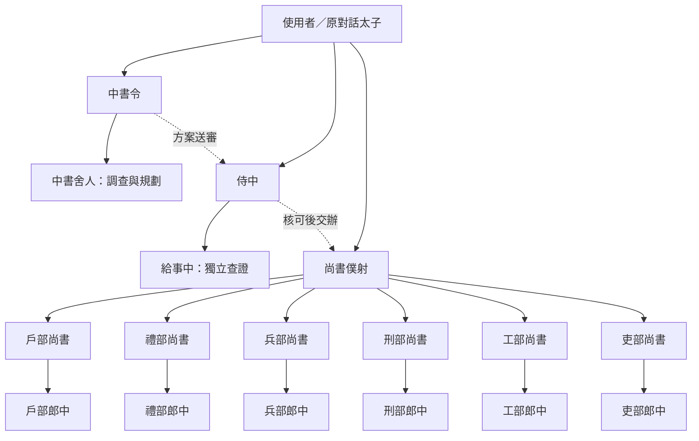

# Edict for Orca

三省六部多代理協作，直接在目前的 Orca 對話中規劃、派工、驗收與結案。

[](https://github.com/Splendent/edict-orca/actions/workflows/ci.yml)
[](https://github.com/Splendent/edict-orca/releases)
[](LICENSE)

各省部由頭領管理自己的執行代理。一道指令包含多件工作時，中書拆成可獨立驗收的工作，門下審查，尚書交給對應部門；各部可在授權範圍內平行執行，由頭領核對成果後交涉與彙整。

**[快速開始](#快速開始) · [角色架構](#角色架構) · [使用範例](#使用範例) · [文件導覽](#文件導覽) · [問題回報](https://github.com/Splendent/edict-orca/issues/new/choose)**

本專案將 [cft0808/edict](https://github.com/cft0808/edict) 的三省六部流程改編為 Orca 對話可使用的命令列與手動技能。來源與改編責任見 [NOTICE.md](NOTICE.md)。

0.4 系列使用 v2 資料。已在 macOS、Orca 1.4.249 與 Codex 驗證三省、部尚書及郎中的完整交接、刑部驗收、門下結案與限定範圍取消；證據見 [原生驗證紀錄](docs/verification/native-2026-11-05.json)。這不代表所有代理、主機、恢復或任意開發任務均已實測。

在目前對話手動執行一次 `/edict init`，選擇代理與模型並完成啟用後，正常交代工作；一般問答直接回答。Codex 原生入口是 `$edict init`。其他對話預設停用，不安裝 hook、背景輪詢或常駐模型程序。

## 提供的功能

| 功能 | 實際行為 |
| --- | --- |
| 頭領與執行代理分工 | 中書令管理舍人、侍中管理給事中、尚書僕射管理六部尚書，各部尚書管理郎中 |
| 三個獨立決策 | 門下方案放行、刑部成果驗收、門下結案，分別保存證據 |
| 多工作派工 | 依工作世代、相依與讀寫範圍管理委派，核對衝突及資源占用 |
| 角色與職位設定 | 明確選擇 Claude Code、Codex 或 Cursor，保存代理、模型及推理強度 |
| 工作控制與恢復 | 暫停、恢復、取消及重新開始；未確認的原生結果保留操作收據供核對 |

本專案以 Orca 原生 Run、Task、Dispatch 與對話交涉運作。原版的網頁看板、OpenClaw Gateway、通訊軟體通知與新聞排程不在此套件內。

## 快速開始

以下為 macOS／POSIX shell 操作；Windows 完整安裝尚未驗收。需要 Node.js 20 以上、Git、Orca，以及已登入的代理工具。

1. 取得已發布版本並檢查來源。

   ```sh
   git clone --branch v0.4.0-beta.4 https://github.com/Splendent/edict-orca.git
   cd edict-orca
   node scripts/install-local.mjs --dry-run
   ```

2. 確認安裝位置後建立指令與技能連結。

   ```sh
   node scripts/install-local.mjs
   node bin/edict.mjs --version
   ```

   預期版本為 `edict-orca 0.4.0-beta.4`。保留此目錄，技能連結會指向它。此步驟不啟用任何對話。

3. 在 Orca 的 **Settings → Orchestration → Nested worker depth** 設定至少 `3`。
4. 在要工作的對話執行 `/edict init`；Codex 執行 `$edict init`。依提示選擇代理與模型，完成後查詢 `/edict status` 或 `$edict status`。
5. 直接交代工作，例如「修正登入錯誤、更新使用文件，附上各項驗證結果」。代理依流程分工，使用者不必逐層轉交。

從 v1 使用新版時，請先讀 [新狀態與更新方式](docs/getting-started.md#從舊版開始使用-v2)。完整安裝、聊天選項、終端機初始化及預期結果見 [首次使用指南](docs/getting-started.md)。

## 角色架構



實線表示管理及派工關係，虛線表示業務交接。三省頭領由原對話平行建立；門下與尚書須取得該工作的正式授權才能處理業務。執行代理不能再建立下層代理。

| 角色 | 頭領／執行職位 | 責任 |
| --- | --- | --- |
| 中書省 | 中書令／中書舍人 | 理解需求、調查、拆分工作、保存正式方案 |
| 門下省 | 侍中／給事中 | 審查方案、退回問題、核對結案證據 |
| 尚書省 | 尚書僕射／左右司郎中 | 協調六部、追蹤相依、彙整結果 |
| 戶部、禮部、兵部 | 各部尚書／郎中 | 資料與成本、文件與規範、工程實作 |
| 刑部、工部、吏部 | 各部尚書／郎中 | 獨立驗收、建置與基礎設施、代理設定與權限 |

必要實作須交付有效成果並結束原生執行，再經刑部驗收及門下結案才進入 Done。暫停關閉新准入；已送出的操作仍需核對。取消須等原生停止或結束證據成立，才可宣稱取消完成。

詳細授權、世代、成果及決策資料見 [角色與資料契約](skills/edict/references/workflow.md)。

### 查看下層派工

分頁名稱顯示職位、具體子工作、直接上級與成員短碼，例如 `兵部郎中｜W-001 冰霜特效｜←兵部尚書｜a1b2c3d4`。終端已存在但缺少可見版面時，Edict 透過 Orca 顯示該分頁，再返回呼叫者分頁；共用分頁時只命名該代理面板。顯示失敗會另行記錄，不重新派工。

詢問 `/edict status` 或 `$edict status` 時，代理依最後同步的 `hierarchy` 列出頭領與所有下屬、負責工作、原生狀態與工作樹。未同步狀態須明列未確認，跨工作樹的下屬也會保留在派工關係中。

Orca 側邊欄仍依工作樹分組，Edict 的派工樹由狀態回報呈現。沒有可用終端分頁的代理保留原啟動方式，並標示顯示功能不可用。

## 使用範例

以下是工作要求示例，不是執行結果紀錄。

```text
修正登入錯誤、更新使用文件，並確認安裝步驟可用。
每項工作分別列出交付物及驗證結果；需要外部發布時先交給我確認。
```

中書整理工作與相依，門下核對方案；尚書將工程交兵部、文件交禮部、安裝與建置交工部，各部頭領分派自己的執行代理。只有實際需要的部門才派工，是否能平行取決於方案及檔案範圍。刑部驗收成果，尚書彙整，再由門下確認結案。

```text
先暫停這項工作的新增派工，列出目前仍在執行及結果未確認的操作。
```

原對話按指定工作套用控制並查證狀態；不把「已收到取消要求」當成程序已停止。內部 JSON 與原生收據不需要由使用者逐次輸入。

## 安裝與環境

需要 Node.js 20 以上、Git、可用的 Orca，以及使用者已登入的 Claude Code、Codex 或 Cursor。先核對手上的原始碼，再於套件根目錄安裝；以下指令不下載或發布版本：

```sh
node scripts/install-local.mjs --dry-run
node scripts/install-local.mjs
node bin/edict.mjs --version
```

安裝器建立命令與手動技能連結，不啟用對話、不修改代理模型或工作專案。`~/.local/bin` 未在 PATH 時，可用 `node /套件絕對路徑/bin/edict.mjs`；技能也附有 `skills/edict/scripts/edict.mjs` 入口。套件是連結目標，安裝後須保留。

階層需要 Orca 的原生深度至少 3，對應「root → 尚書僕射 → 部尚書 → 郎中」。由使用者在 **Settings → Orchestration → Nested worker depth** 確認。Edict 不自行改 App 設定；深度拒絕時保留操作收據並回報，不另開 Run 或改模型繞過限制。

## 啟用、設定與對話身分

| 對話命令 | 行為 |
| --- | --- |
| `/edict init` | 問代理／模型、保存設定，啟用目前對話 |
| `/edict status` | 顯示 active、角色設定與協作工作摘要 |
| `/edict config` | 修改此對話未來派工的角色或職位設定 |
| `/edict off` | 關閉新派工與推進，保留資料，不自動取消現有代理 |
| `/edict update` | 手動更新共用安裝並由本對話重讀指引 |
| `/edict help` | 顯示說明，不啟用 |

Codex 將 `/edict` 換成 `$edict`。安裝、引用範例及一般工作要求均不代表授權 init。`--yes` 只供代理保存使用者已明確選擇的設定，不代表可自選供應商或模型。

CLI 優先沿用代理的原生對話 ID；缺少原生 ID 時，首次 init 回傳 `conversation:UUID`。保留該 ID，後續明確傳 `--session`；不得用專案、終端機或最近一份狀態猜測。壓縮摘要需保留 EDICT_HOME、session、active、模型設定、各 Run 與未完成操作。失去 ID 或上下文時回報，不默默重建。

session、config 與工作資料只接受 v2，不支援 v1 匯入或自動遷移。驗證本實作時使用獨立的新 EDICT_HOME，將同一路徑交給所有下屬；保留原資料及原有工作，不刪除或覆寫它們。既有 v1 對話不能直接套用新版 CLI 繼續工作。

設定完整保留所有角色的 agent／model／effort。`positionOverrides` 可為個別角色的 head 或 executor 保存完整三欄；省略整組就繼承角色設定，null model 明確使用該代理工具預設。不逐欄混用不同供應商設定，不自動降級。

以下變數均須填入本對話的實際值；模型先經使用者指定：

```sh
edict config --session "$EDICT_SESSION_ID"
edict config set bingbu --session "$EDICT_SESSION_ID" --position executor --agent "$SELECTED_AGENT" --model "$SELECTED_MODEL"
edict config set bingbu --session "$EDICT_SESSION_ID" --position executor --inherit
```

修改設定不更換執行中的代理；續辦沿用原成員設定快照。完整 v2 設定可在首次 init 時用 `--import-config` 匯入，已有設定不得再匯入覆寫。

## Cursor 持續啟用

Cursor 作為目前對話的協調者時，init 帶 `--coordinator cursor`。首次保存為 active=false、pending=cursor-custom-mode；使用者需在原生技能選單選 **Use as Mode**，確認輸入框的模式標記後，代理再以同一 session 執行 `--mode-confirmed`。沒有介面證據或使用者確認時不得宣稱啟用。

當地介面缺少此模式時保持 pending，明列未支援／未驗證；不要要求每則訊息重新附加技能來冒充持續啟用。off 後退出模式標記，尚未退出也仍須遵守停用狀態；再次 init 須重新確認。Cursor 作為 worker 的模型設定與此事分開。

## 代理內部流程

使用者不必逐次轉交或手動輸入內部命令。代理依 [協調流程](skills/edict/references/active.md)、[角色與資料契約](skills/edict/references/workflow.md)及[派工、訊息與恢復](skills/edict/references/scheduling.md)操作。

| 階段 | 入口與決策者 |
| --- | --- |
| 建立需求與三省 | root 先比對在途項目決定並行或排隊，`run open`、`work add`，無 work 的 `team ensure` 建立三省平行頭領；修訂需求資源或擴大讀取範圍用 `work amend` |
| 規劃與送審 | 中書 `work plan`（含並行分析），以 `team ensure menxia --work` 授予既有門下工作範圍，再 `team send` |
| 放行與實作 | 門下 `review record` 記 plan-approval；中書或門下授予既有尚書工作；尚書建六部頭領，各部 `delegate` |
| 成果與驗收 | implementation executor `work result`；刑部 artifact-acceptance；原生結束後 `sync` |
| 結案與控制 | 門下 closure-confirmation 才能 Done；root `control pause/resume/cancel/restart` |

門下與尚書的空頭領沒有業務 scope。root 建立它們不等於代替中書送審或門下批准；原生 creator 保持 root，正式業務來源仍是中書／門下。所有指定 work 的方案、授權、委派、審查及訊息均帶目前 generation；成果以 operation 綁定原世代。

`team send` 使用成員 ID，`team forward` 使用需 owner 代送的訊息 ID。結果未知用原操作的 `recover` 核對，不另建派工。舊 `dispatch`、`task-create`、`dispatch-ready`、`continue` 入口明確拒絕，不作為免核可替代路徑。

## 支援與驗證範圍

| 對象 | 可主張的範圍 | 尚未完成的驗證 |
| --- | --- | --- |
| v2 設定與工作政策 | 本機模擬測試涵蓋角色、核可、世代、控制、收據及範圍 | 模擬身分不等於原生身分隔離驗收 |
| macOS、Orca 1.4.249、Codex | 具原生身分的中書送審、門下核可、尚書→部尚書→郎中、刑部驗收、門下結案與限定範圍取消成功 | 有界報告任務；不涵蓋任意開發任務、所有恢復或取消交錯 |
| Claude Code、Codex、Cursor | 可明確設定各角色及職位的代理與模型 | 不宣稱各供應商完整多輪、所有模型及壓縮恢復皆成功 |
| v0.4.0-beta.1 CI | [發布提交的五組 CI 成功](https://github.com/Splendent/edict-orca/actions/runs/41993409294)：macOS／Ubuntu Node 20／24 完整測試與 Windows Node 24 更新器測試 | 不代表 Windows 完整安裝或所有平台原生階層流程已驗收 |

`doctor` 只讀取 help 與執行環境狀態，不派工、不消費信箱。它檢查既有基本介面，不認證完整階層流程、請求去重、Nested worker depth、帳號或特定模型。工作狀態以 Orca 為原生來源；Edict 另保存委派、控制、決策、證據及操作意圖。

政策檢查防止正常代理經 Edict 入口越權，不是同一 OS 帳號的安全沙箱。其他程式仍可能直接修改檔案或呼叫工具；既有 sandbox 及專案授權必須持續生效。commit、merge、push、部署及外部傳送不由流程自動授權。

## 更新與移除

更新只在使用者明確要求時執行，`update` 只取得已發布版本。本方案不設計舊版遷移、跨版本續辦或降版；驗證與使用新架構採全新 v2 狀態，既有資料不自動轉換或清除。

更新器選官方已發布版本，拒絕不符來源、有本機修改、未追蹤檔案或更新鎖的安裝；不用 pull、merge、reset 或自動重試。它仍在共用安裝根目錄切換版本，沒有實作按 Run 保留不可變程式版本的發布機制。後續 CLI 都受影響，其他對話不會自動啟用或重讀。檔案更新完成後，當前代理按 `reload.files` 重讀四份指引及 context，才回報已重讀；不可承諾跨不相容版本的在途相容。

移除前在原對話 off，確認原生工作結束；只移除已核對指向本套件的連結：

- `~/.local/bin/edict`
- `~/.agents/skills/edict`
- `~/.claude/skills/edict`（自訂 CLAUDE_CONFIG_DIR／ORCA_CLAUDE_CONFIG_DIR 時依實際位置）
- `~/.cursor/skills/edict`

保留套件以外的檔案及 EDICT_HOME 內資料。Windows 安裝與移除未完整驗證，不直接套用 POSIX 連結操作。

## 開發驗證

```sh
npm ci --ignore-scripts
npm test
npm run check
```

測試使用隔離資料及模擬原生介面，不使用供應商憑證。設計與尚未驗收的能力見 [階層協作設計](docs/hierarchical-orchestration-design.md)；設計目標不自動成為本實作的已驗證功能。

## 專案結構

| 路徑 | 內容 |
| --- | --- |
| `bin/`、`scripts/` | CLI 入口與本機安裝器 |
| `src/` | 設定、對話狀態、階層工作流程、原生 Orca 介面與更新器 |
| `skills/edict/` | 手動技能、協調流程及角色資料契約 |
| `test/`、`.github/` | 自動測試、CI、議題／PR 範本及維護設定 |
| `docs/` | 使用指南、設計、研究及實測證據 |

## 文件導覽

| 需求 | 文件 |
| --- | --- |
| 安裝、首次啟用、聊天設定與更新 | [首次使用指南](docs/getting-started.md) |
| 技能未出現、初始化、深度限制與結果未確認 | [故障排除](docs/troubleshooting.md) |
| 代理協調、角色權限、資料及恢復 | [協調流程](skills/edict/references/active.md)、[工作契約](skills/edict/references/workflow.md)、[派工與恢復](skills/edict/references/scheduling.md) |
| 設計及實測依據 | [階層設計](docs/hierarchical-orchestration-design.md)、[控制語意](docs/research/control-semantics.md)、[原生驗證](docs/verification/native-2026-11-05.json) |
| 開發、回報、授權與維護 | [貢獻指南](CONTRIBUTING.md)、[安全政策](SECURITY.md)、[行為準則](CODE_OF_CONDUCT.md)、[維護指南](docs/maintainers.md)、[來源](NOTICE.md)、[MIT 授權](LICENSE) |

## 回報與貢獻

一般問題、可重現錯誤與功能提案請使用 [議題範本](https://github.com/Splendent/edict-orca/issues/new/choose)。公開日誌前移除憑證、私有路徑及對話內容；安全漏洞依 [安全政策](SECURITY.md) 處理。提交修改前請讀 [貢獻指南](CONTRIBUTING.md)。
